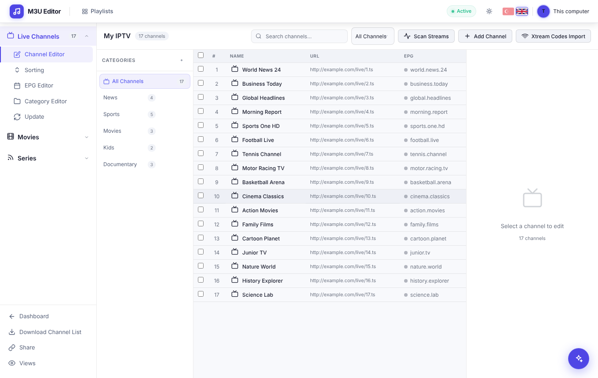

## M3U Editor 1.11.0 — the desktop release

M3U Editor now runs as a **desktop application on Windows and Linux**. No server, no Docker, no database to set up and no account to create: install it, open it and start editing your playlists. Your data stays on your computer.

### Download

| System | File | How to install |
| --- | --- | --- |
| **Windows 10 / 11** (64-bit) | `M3U-Editor-Setup-1.11.0-x64.exe` | Double-click it. No administrator rights needed. The installer is not code-signed yet, so if SmartScreen warns you, choose **More info → Run anyway**. |
| **Linux — any distribution** | `M3U-Editor-1.11.0-x86_64.AppImage` | `chmod +x M3U-Editor-1.11.0-x86_64.AppImage`, then run it. `libfuse2` is not required. |
| **Debian / Ubuntu / Pardus / Mint** | `M3U-Editor-1.11.0-amd64.deb` | `sudo apt install ./M3U-Editor-1.11.0-amd64.deb` |
| **Fedora / RHEL / openSUSE** | `M3U-Editor-1.11.0-x86_64.rpm` | `sudo dnf install ./M3U-Editor-1.11.0-x86_64.rpm` |

### What is different on the desktop

- **No sign-in.** On first start the app prepares its database and a local account by itself and opens straight on your playlists.
- **Your data lives on your computer:** `%APPDATA%\M3U Editor` on Windows, `~/.config/M3U Editor` on Linux (*File → Open data folder*). Back up the whole folder — without `secrets.json` the encrypted Xtream passwords cannot be read. Uninstalling the app does not delete it.
- **Local AI models work out of the box:** Ollama (`http://localhost:11434/v1`) and LM Studio (`http://localhost:1234/v1`) can be picked as the assistant's provider.
- Scheduled syncs, EPG refreshes and assistant tasks run while the app is open.
- Xtream output and share links point to `127.0.0.1`, so other devices cannot use them — export the M3U/XMLTV file instead, or run the web version on a server.

**Troubleshooting:** if the app reports that it could not start, *Open log folder* shows `server.log` and `postgres.log`. Do not run it as root on Linux. On Ubuntu 24.04 and later, if the AppImage closes immediately, start it with `--no-sandbox` or use the `.deb` package.

### Other highlights in this release

- **Security:** the assistant's approval and delete-permission checks can no longer be bypassed; scheduled tasks can only touch the playlist they are bound to; stored Xtream passwords and the AI key are only ever sent back to the server they were saved for; double-clicking *Approve* no longer runs an action twice. Dependency audits report no known vulnerabilities.
- **Reliability:** failing syncs and EPG downloads back off instead of retrying every minute; automatic backups no longer push out your manual ones; manual EPG matches survive auto-matching; syncing keeps your channel order and category moves; channels are not deleted when a provider temporarily returns only part of a list.
- **Interface:** notifications show again, tabs no longer sign each other out, error messages are translated in the English interface, and the assistant has a **Stop** button.
- **Server (Docker) installs:** `SEARXNG_SECRET` is now required (`openssl rand -hex 32`); two new database migrations apply automatically on start.

Full details: [CHANGELOG.md](https://github.com/fyildirim-debug/M3uEditor/blob/main/CHANGELOG.md)
